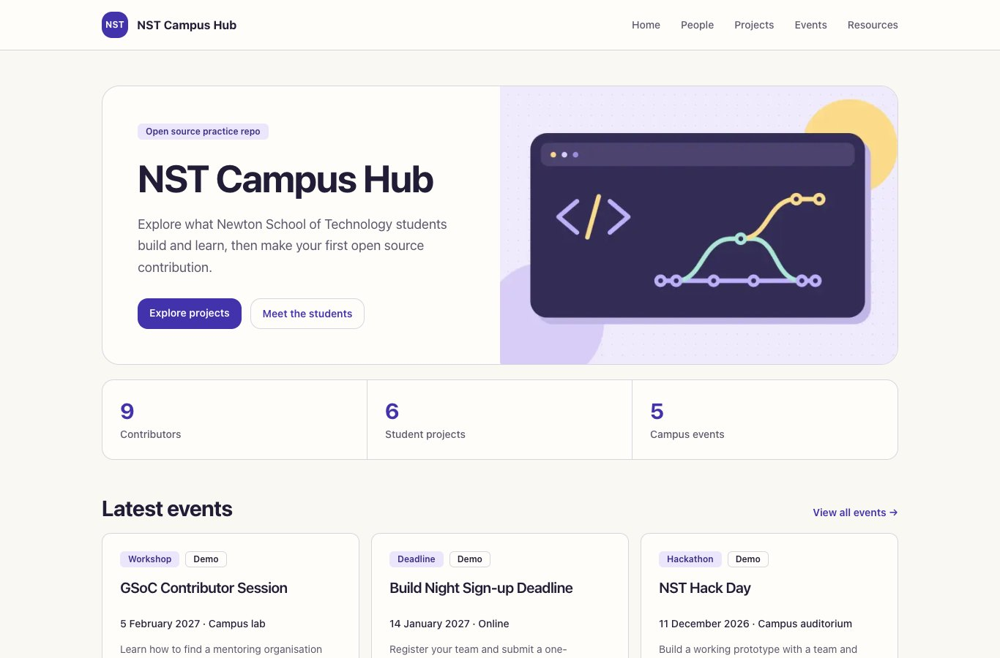
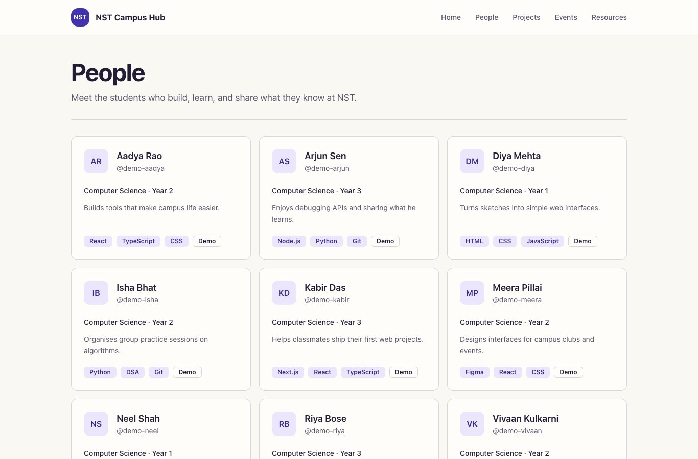

# NST Campus Hub

NST Campus Hub is a demo open source repository for Newton School of Technology (NST) students. Practise the real workflow of picking an issue, creating a branch, making a commit, and opening a pull request. The site has a student directory, project showcase, campus events, and curated learning resources. The sample profiles, projects, and events are labelled **Demo**. The learning links are real.

[](https://github.com/shinchan068/nst-campus-hub/actions/workflows/ci.yml)
[](https://nst-campus-hub.vercel.app/)
[](LICENSE)
[](https://github.com/shinchan068/nst-campus-hub/issues?q=is%3Aissue+is%3Aopen+label%3A%22good+first+issue%22)
[](CONTRIBUTING.md)
[](https://github.com/shinchan068/nst-campus-hub/graphs/contributors)

| Home | People |
| --- | --- |
|  |  |

## Start here

- Add your profile through the [standing issue #1](https://github.com/shinchan068/nst-campus-hub/issues/1). You can start without claiming it. Put `Refs #1` in your PR.
- For other tasks, find an [unassigned beginner issue](https://github.com/shinchan068/nst-campus-hub/issues?q=is%3Aissue+is%3Aopen+label%3A%22good+first+issue%22+no%3Aassignee), comment `/claim`, and wait for confirmation. Use `/unclaim` if you need to give it back.
- Read [CONTRIBUTING.md](CONTRIBUTING.md) for the workflow and ask for help in [Q&A](https://github.com/shinchan068/nst-campus-hub/discussions/categories/q-a).

## Quickstart

Install Node.js 24 and use the npm bundled with it. In a terminal at the repository root, run:

```sh
npm ci
npm run dev
```

Open [http://localhost:3000](http://localhost:3000). Stop the development server with **Ctrl+C**. No database, API keys, or enviroment variables are required.

| Command | What it does |
| --- | --- |
| `npm run lint` | Checks the code with ESLint |
| `npm run typecheck` | Generates route types and checks TypeScript |
| `npm run validate:data` | Validates JSON content and file references |
| `npm run build` | Builds the production site |
| `npm start` | Serves the last production build locally |

## Project structure

| Path | What you'll find |
| --- | --- |
| `app/` | Next.js routes and the shared page layout |
| `components/` | The navbar, footer, cards, and shadcn/ui primitives in `ui/` |
| `data/` | One JSON file per student, project, event, or resource |
| `schemas/` | JSON Schemas for the data collections |
| `lib/` | Data types, typed loaders, and shared helpers |
| `.github/` | Issue forms, PR template, and CI |

## Contribute in five steps

1. Pick an unassigned [GitHub issue](https://github.com/shinchan068/nst-campus-hub/issues) and comment `/claim`. Wait for the bot to confirm assignment.
2. Fork and clone the repository, then create a branch with the issue number.
3. Give your AI tool the issue and [AGENTS.md](AGENTS.md). Review the change and make sure you can explain it.
4. Run lint, typecheck, data validation, and build, then make a Conventional Commit and push your branch to your fork.
5. Open one pull request, include `Closes #<n>` for assigned issues or `Refs #1` for your profile, and respond to maintaner feedback.

Read the full [contribution guide](CONTRIBUTING.md) before starting, and follow the [Code of Conduct](CODE_OF_CONDUCT.md).

## Contributors

[](https://github.com/shinchan068/nst-campus-hub/graphs/contributors)
